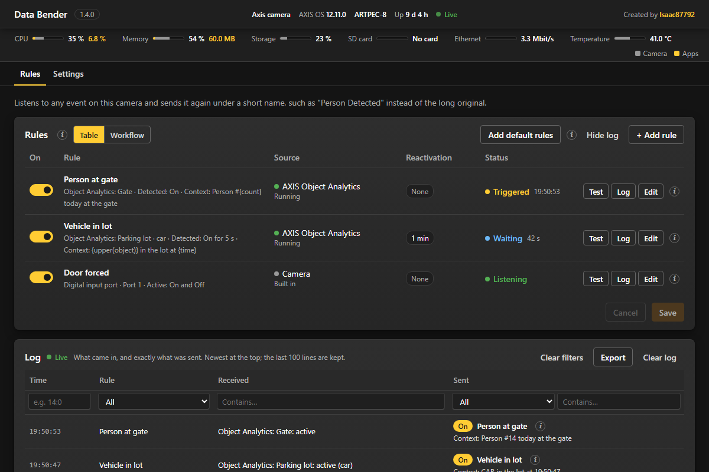
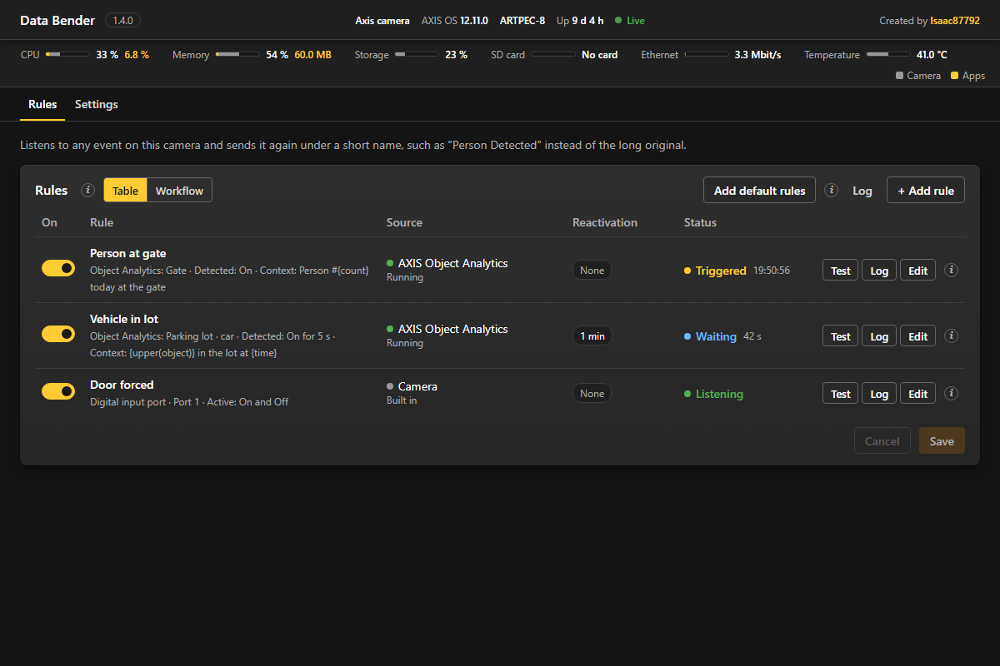
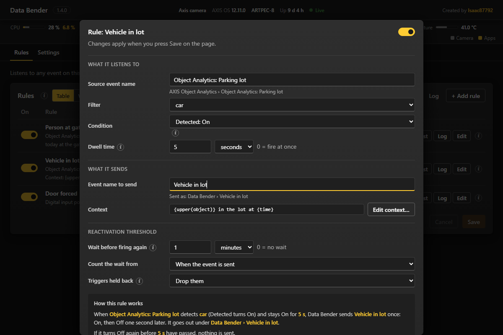
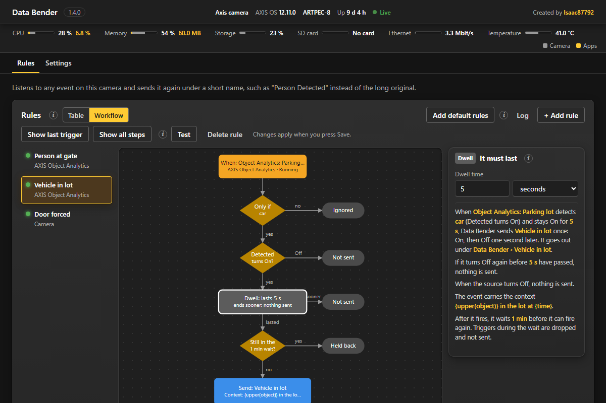
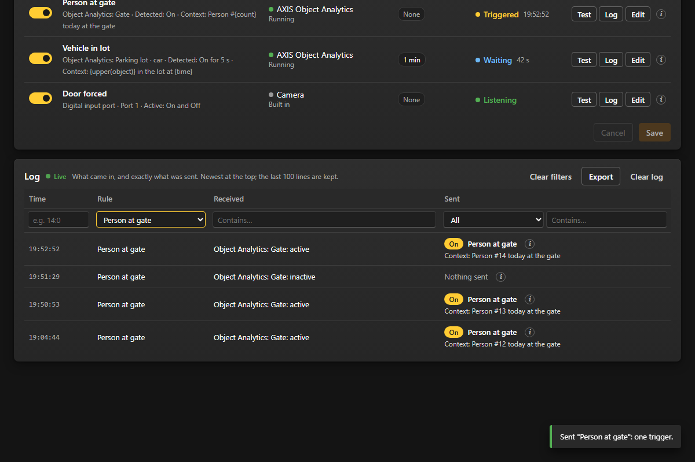
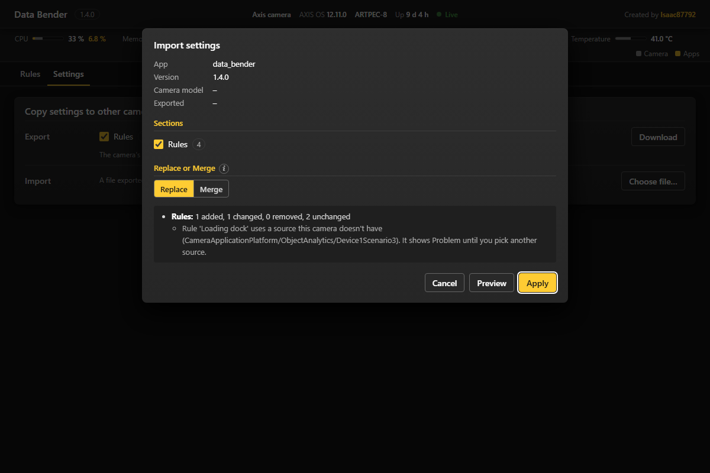
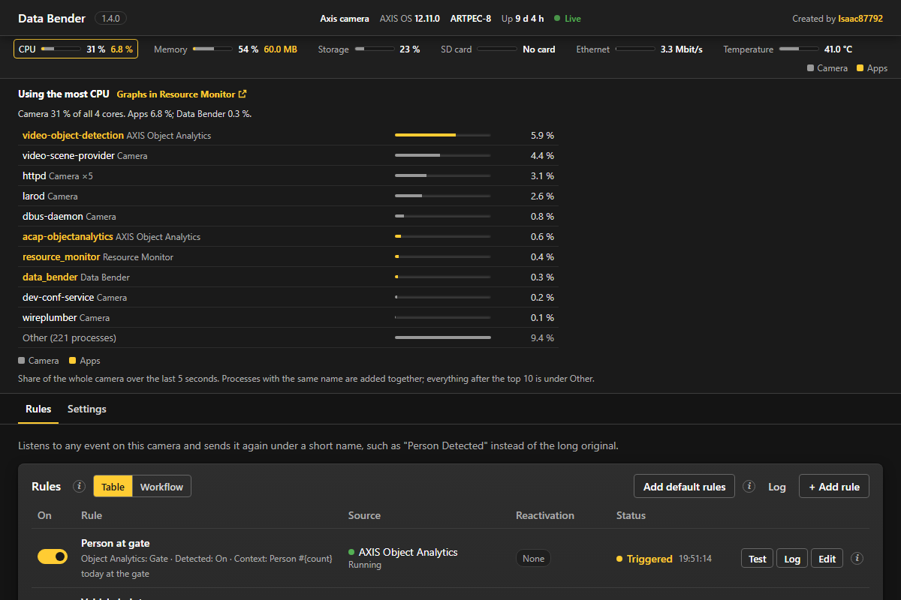

### Tip up front:  
If you want to download this product already packaged, look under 'Releases' for the latest version. Download it, unblock it if necessary (Right Click Properties, Unblock), upload it to your device, and start it.

# Data Bender for Axis cameras

**Give your camera's events the names you want.** Data Bender is an ACAP app that listens to any event on an Axis camera and sends it again under a short name that you choose, such as "Person at gate" instead of a long technical one. Video management systems show events by the names the camera gives them, and an app can't rename another app's events, so Data Bender sends its own copy, in the same On/Off format that AXIS Object Analytics uses.

## Why use it

- **Names people understand.** Operators see "Door forced" or "Vehicle in lot" in the VMS, not a topic path.
- **Any event, one place.** AXIS Object Analytics scenarios, digital inputs, other apps' events: anything the camera lists can be a source.
- **Fewer false alarms.** Filters, a dwell time and a wait before firing again cut out the noise before it reaches the VMS.
- **Same setup everywhere.** Export the rules from one camera and import them on the others, by hand or from a fleet tool.

## Key features

### Rules table
One line per rule: an On switch, the rule's name and summary, its source app with a light (running or stopped), the wait before firing again, and the status in plain words (Listening, Triggered, Waiting, Disabled, Problem, Not saved). **Add default rules** adds Person and Vehicle rules matched to the camera's Object Analytics scenarios.

### Rule editor
Every setting of a rule in one dialog: the source event (search the camera's own event list), a filter (for example only cars, or only input port 1), On, Off or both, a dwell time, the name to send, a **Context** text with fields and formulas such as `Person #{count} today at the gate`, a [Port Testing](https://github.com/Isaac87792/Axis-ACAP-PortTesting) match or port check to start each time the rule fires (**Also do**), and a wait before firing again. "How this rule works" says it back in plain words.

### Workflow view
Each rule drawn as a flowchart: source, filter, condition, dwell, wait and what is sent. Click a step to change it on the right; **Show last trigger** marks the steps the last source event reached.

### Test and Log
**Test** sends the rule's event now, so you can check that the VMS receives it. **Log** shows what came in and exactly what was sent (name, On or Off, context), or why nothing was sent. A rule's own Log button shows only that rule's lines; there is a filter per column, Export to CSV, and the last 100 lines are kept on the camera.

### Copy settings to other cameras
On the Settings tab: **Export** the rules to a file, **Import** it on another camera with **Replace** or **Merge**, see a **Preview** of what would change before anything is saved, then **Apply**. A rule whose source the other camera doesn't have is kept and marked. **Undo last import** puts the rules back. Fleet tools can do the same over HTTP (`/local/data_bender/configio`, administrators only).

### Resource bar
The top of the page shows the camera's CPU, memory, storage, SD card, network and temperature, with the camera in grey and the installed apps in yellow. Click a reading for details, such as the processes using the most CPU. When [Resource Monitor](https://github.com/Isaac87792/Axis-ACAP-ResourceMonitor) is installed, a link opens its graphs.

## Works with Resource Monitor
Data Bender and [Resource Monitor](https://github.com/Isaac87792/Axis-ACAP-ResourceMonitor) are made to run side by side on the same camera.
- **Rename Resource Monitor alerts.** Each Resource Monitor alert is a camera event, so a Data Bender rule can use it as its source: send "CPU high" as "Camera overloaded", only when it lasts, or with your own Context text.
- **See the whole picture.** When Resource Monitor runs on the camera, the resource bar has a link to its graphs, where Data Bender shows up with every other app.
- **One look, one way of working.** Both use the same dark layout, colours (the camera in grey, apps in yellow), Help (i) buttons, Test and Log buttons, and Workflow view.
- **Set up many cameras the same way.** Both have "Copy settings to other cameras" with the same file format, Replace or Merge, a preview and Undo. Build the rules and alerts on one camera, then copy both apps' settings to the rest.

## Works with Port Testing
When the [Port Testing](https://github.com/Isaac87792/Axis-ACAP-PortTesting) app runs on the same camera, a rule can also start a match (Pong or Battleship, 1 to 15 minutes) or a port check with one of Port Testing's devices each time it fires, for example to test the link to another camera when a door opens.
- **No password kept.** Data Bender asks Port Testing on the camera itself, with the camera's own service account.
- **Same rules as the event.** The dwell time and the wait before firing again apply, and no second match starts while one is playing.
- **In the log.** Each result is there in plain words: started, already playing, or why it could not start.
- **Its events as sources.** Port Testing's own events (Match playing, Link trouble, Match won) can be a rule's source like any other.

Without Port Testing, the rule shows "Port Testing not installed"; a start saved with a rule is kept and does nothing until it is installed.

## Built to be a good guest on the camera

- **Light:** runs at a lower priority than the camera's own work, and shows its own CPU and memory use so you can check it.
- **Bounded:** nothing grows without limit (32 rules, 256 active sources per rule, the last 100 log lines); the app watches its own memory and restarts itself cleanly if it ever passes its limit.
- **Touches only what changed:** saving or importing changes only the rules that changed, so the other rules keep listening.
- **Never listens to itself:** its own events can't be a source, so rules can't loop.
- **Respects camera roles:** every page and setting needs an administrator login.

## Requirements

- An Axis camera with an **ARTPEC-8 or newer** chip (aarch64).
- **AXIS OS 12.8 up to AXIS OS 13.**
- AXIS OS 13 runs only apps signed by Axis: use a signed release. A package you build yourself is unsigned and needs the camera setting **Allow unsigned apps** (AXIS OS 12).

## Install

1. Download the latest `.eap` file from [Releases](../../releases).
2. In the camera's web page, open **Apps**, choose **Add app** and select the file.
3. Start **Data Bender** and open it.

Installing a newer version over an older one keeps your rules.

To build it yourself: `./build.sh` (Docker), or `sudo tools/build-lab.sh aarch64` on a Linux machine without Docker, from the repository's root folder.

## License

MIT. See [LICENSE](LICENSE). The ACAP wrapper in `app/ACAP.c` and `app/ACAP.h` is Fred Juhlin's, under its own MIT license in [app/LICENSE](app/LICENSE); cJSON (`app/cJSON.c`, `app/cJSON.h`) is MIT licensed, as given at the top of those files.
